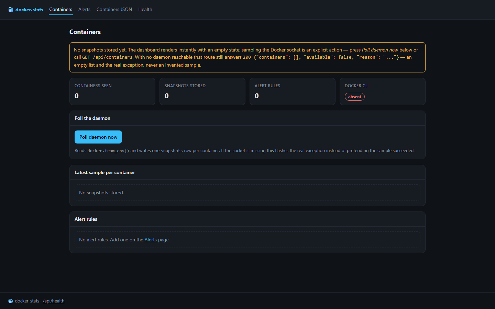
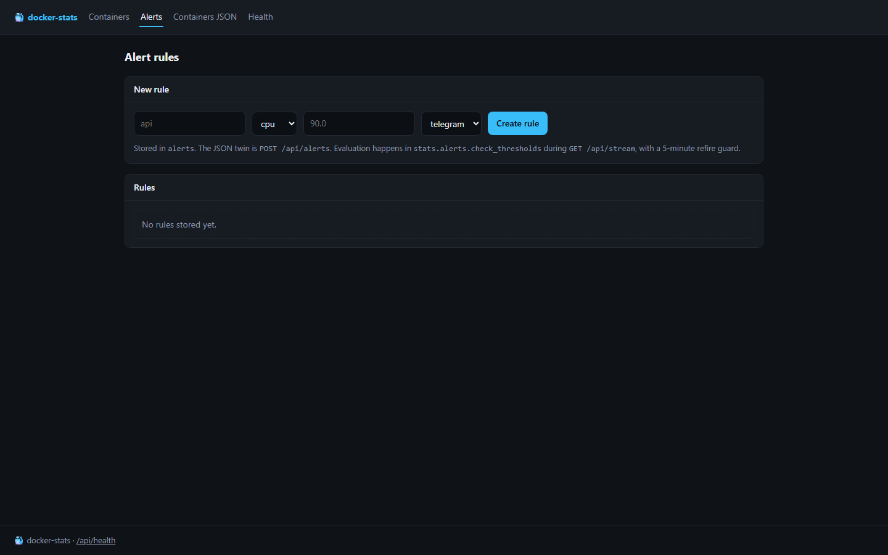
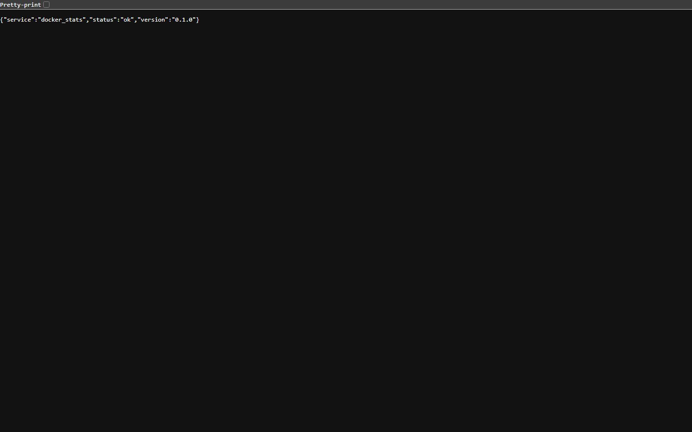
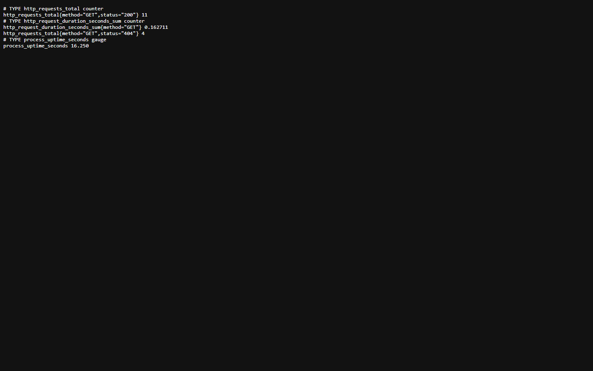
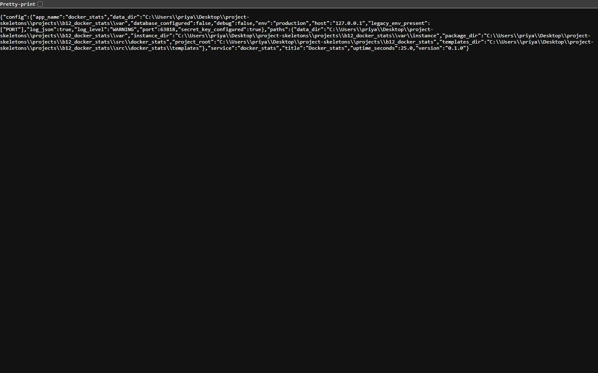

<p align="center">
  
</p>

<h1 align="center">containerscope</h1>

<p align="center"><b>Per-container CPU and memory history, with alerts that are rows.</b></p>

<p align="center">
  <a href="#quality-gates"></a> <a href="#quality-gates"></a> <a href="#api"></a> <a href="#requirements"></a> <a href="LICENSE"></a>
</p>

containerscope reads the Docker API for live container stats, keeps a short history per container, tails logs and evaluates alert rules against the same numbers.

---

**Contents** &nbsp;·&nbsp; [Why](#why-this-exists) &nbsp;·&nbsp; [What it does](#what-it-does) &nbsp;·&nbsp; [Quickstart](#quickstart) &nbsp;·&nbsp; [API](#api) &nbsp;·&nbsp; [Screenshots](#screenshots) &nbsp;·&nbsp; [Measured](#measured-not-estimated) &nbsp;·&nbsp; [Architecture](#architecture) &nbsp;·&nbsp; [Quality gates](#quality-gates) &nbsp;·&nbsp; [Deploy](#deploy) &nbsp;·&nbsp; [Limits](#limits-stated-rather-than-hidden)

## Why this exists

docker stats is a live view with no memory. Keeping samples means you can answer "when did it spike" — and evaluating rules against stored samples means an alert is a query, not a separate daemon.

## What it does

| Capability | How it works |
| --- | --- |
| **Live stats** | CPU, memory and network per container, read from the Docker socket. |
| **History** | Samples are retained per container for a configurable window. |
| **Log tail** | The last lines of a container's log over HTTP. |
| **Alert rules** | Threshold rules evaluated against the stored samples, listed as rows. |
| **SSE stream** | GET /api/stream pushes samples so the dashboard does not poll. |

## Quickstart

```sh
git clone https://github.com/scar8969/containerscope.git
cd containerscope
python -m venv .venv && . .venv/bin/activate   # Windows: .venv\Scripts\activate
pip install -e ".[dev]"
python wsgi.py                                 # http://127.0.0.1:8000
```

The same work from the CLI:

```sh
python -m docker_stats.cli --help
```

Commands: `ps`, `history`, `alerts`.

A first request:

```sh
curl -s http://127.0.0.1:8000/api/containers | head
```

## Requirements

- Python **3.11+** — CI runs 3.11, 3.12 and 3.13.
- Runtime dependencies: `Flask>=3.0`, `Flask-SQLAlchemy>=3.1`, `SQLAlchemy>=2.0`, `PyYAML>=6.0`, `docker`.
- No JavaScript build step: every page is server-rendered Jinja.

## API

Every route below is in [`openapi/containerscope.yaml`](openapi/containerscope.yaml) and is exercised by the live probe recorded in [`docs/EVIDENCE.md`](docs/EVIDENCE.md).

| Method | Path | What it does |
| --- | --- | --- |
| `GET` | `/api/containers` | live stats |
| `GET` | `/api/containers/<name>/stats` | history |
| `GET` | `/api/containers/<name>/logs` | logs |
| `GET` | `/api/alerts` | list |
| `GET` | `/api/stream` | SSE |

## Screenshots

Captured from the running service with headless Chromium at 1440×900, one image per page, committed under [`docs/assets/screens/`](docs/assets/screens/).

<table>
<tr>
<td width="50%"><br><sub><code>/alerts</code> &middot; 27.2 KB</sub></td>
<td width="50%"><br><sub><code>/healthz</code> &middot; 8.4 KB</sub></td>
</tr>
</table>

<table>
<tr>
<td width="50%"><br><sub><code>/livez</code> &middot; 7.3 KB</sub></td>
<td width="50%"><br><sub><code>/metrics</code> &middot; 14.7 KB</sub></td>
</tr>
</table>

<table>
<tr>
<td width="50%"><br><sub><code>/readyz</code> &middot; 7.7 KB</sub></td>
<td width="50%"><br><sub><code>/version</code> &middot; 25.9 KB</sub></td>
</tr>
</table>

## Measured, not estimated

These numbers were produced on this checkout by `pytest --cov` and by booting `wsgi.py` and issuing one real GET per documented path. The commands are in [`docs/EVIDENCE.md`](docs/EVIDENCE.md).

| Signal | Value |
| --- | --- |
| Tests | **21 / 21 passed** (2.0 s, exit 0) |
| Line coverage | **61.6%** — 421 of 644 statements |
| Source | 15 files / 1,469 lines |
| Test code | 4 files / 215 lines |
| Documented paths | 5 in the spec, 5 GET |
| Live probe | 13 GET requests to the booted app, **13 answered 200** |
| Median latency | **16.1 ms** (single uncached request, dev server) |
| Slowest / fastest | 4008.4 ms `/api/stream` / 5.1 ms `/api/containers` |
| Bytes served | 12.1 KB across 13 responses |
| Screenshots | 7 captured |

## Architecture

```
containerscope/
├── src/docker_stats/
│   ├── http.py                         379  HTTP plumbing for docker_stats: correlation ids, acc
│   ├── config.py                       171  Environment-driven configuration for docker_stats
│   ├── observability.py                169  Structured logging and request correlation for docke
│   ├── stats/api.py                    144  
│   ├── _app.py                         132  Flask application for docker-stats
│   ├── app.py                          119  Application factory for docker_stats
│   ├── errors.py                       108  Typed application errors and their HTTP mapping for 
│   ├── cli.py                           97  docker-stats — command line over stats/collector.py 
│   ├── paths.py                         52  Filesystem layout for docker_stats
│   ├── stats/collector.py               31  
│   ├── models.py                        27  
│   ├── stats/alerts.py                  24  
├── openapi/containerscope.yaml            the contract of record
├── schema/containerscope.sql              the DDL
├── tests/                       the suite that has to stay green
├── docs/EVIDENCE.md             the recorded live route walk
├── Dockerfile                   multi-stage build
└── wsgi.py                      entry point
```

The package keeps one shape across the service: `config.py` reads the environment once, `observability.py` emits structured JSON logs carrying a request id, `errors.py` turns exceptions into a single JSON envelope, `models.py` holds the tables, and the `stats/` package holds the routes.

## Quality gates

| Gate | Command | Threshold |
| --- | --- | --- |
| Suite | `pytest -q` | all green |
| Coverage | `pytest --cov` | floor set in `pyproject.toml` from the measured value |
| Lint | `ruff check src tests` | zero findings |
| Format | `ruff format --check src tests` | zero reformats |
| Types | `mypy src` | zero errors |
| Security | `bandit -c pyproject.toml -r src` | reviewed skip list, no unreviewed finding |
| Live routes | boot `wsgi.py`, one GET per documented path | no 5xx, no undocumented guard |

CI runs the first six on Python 3.11, 3.12 and 3.13 for every push to `main`, plus a container build. See [`.github/workflows/ci.yml`](.github/workflows/ci.yml).

## Deploy

```sh
docker build -t containerscope .
docker run --rm -p 8000:8000 --env-file .env.example containerscope
```

Configuration is environment-only — every variable is documented in [`.env.example`](.env.example), and the service refuses to start with a production secret missing.

## Limits, stated rather than hidden

- Needs the Docker socket; without it the endpoints return an honest "unavailable" envelope with the reason.
- History is in-memory for the process lifetime, not persisted.

## License

MIT — see [LICENSE](LICENSE).
